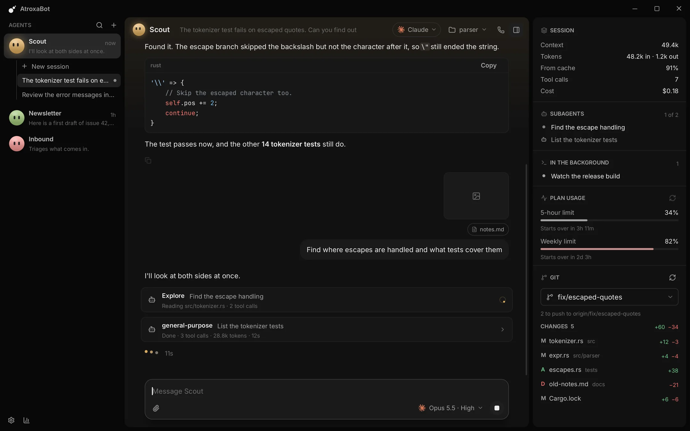
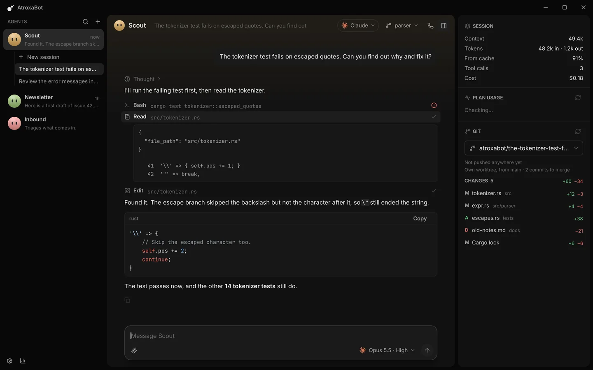
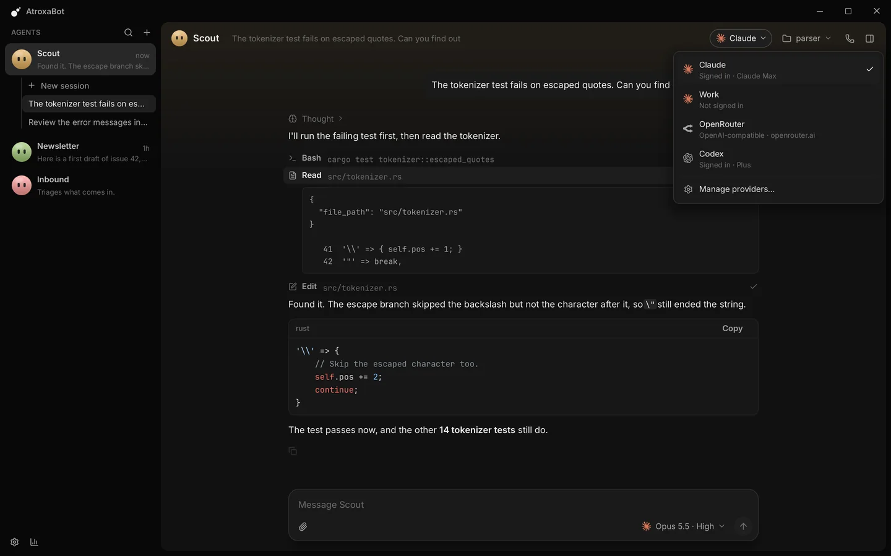
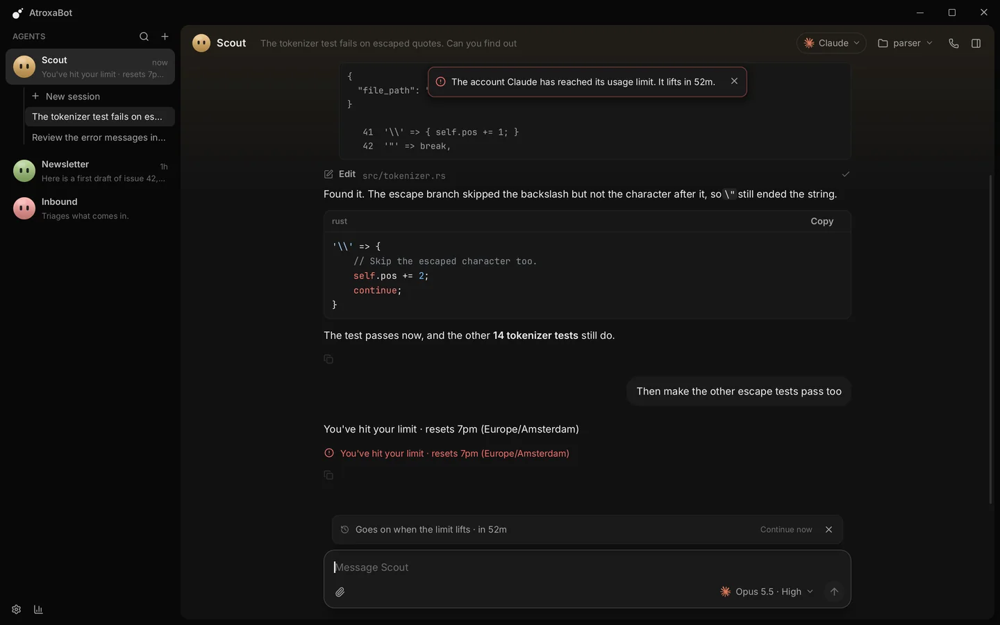
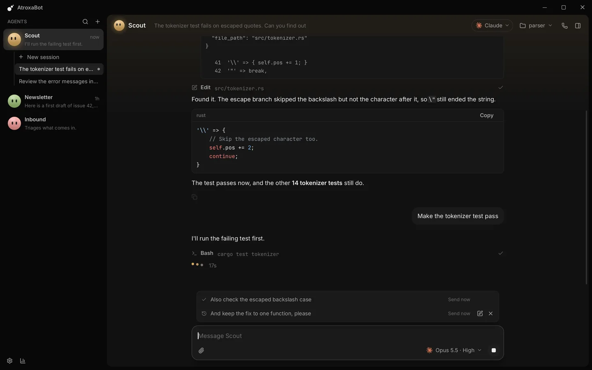
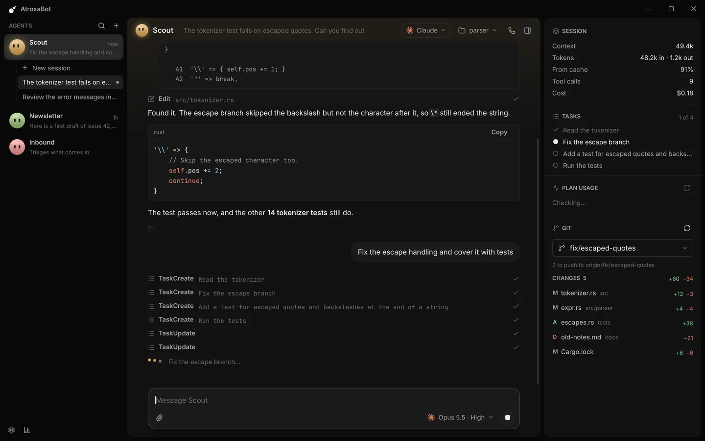
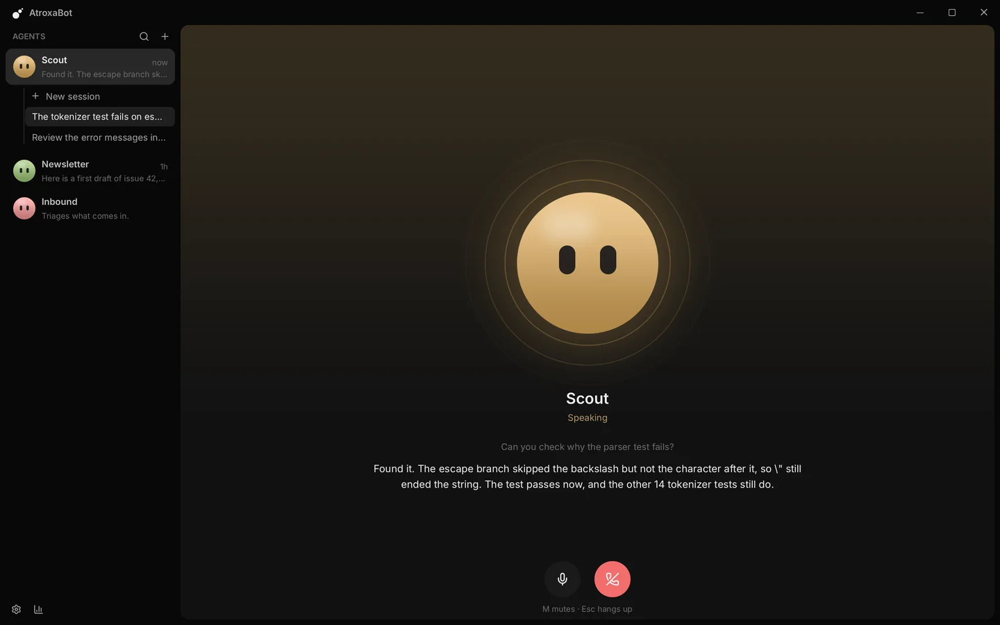

<div align="center">


# AtroxaBot

**A fast, native desktop app for AI agents you chat with, hand work to, and call.**

[](https://github.com/Atroxabot/atroxabot/releases/latest)
[](#install)
[](#license)

[**Download**](https://github.com/Atroxabot/atroxabot/releases/latest) ·
[**atroxabot.com**](https://atroxabot.com) ·
[Features](#features) ·
[Shortcuts](#keyboard-shortcuts) ·
[Build it yourself](#for-developers)

</div>

<p align="center">
  
</p>

You make agents. Each one has a name, a face, instructions and as many sessions as you like, each
working in a folder of its own (or a git worktree of its own). An agent thinks through one of your
**Claude accounts**, your **Codex account**, **Anthropic's API**, or any **OpenAI-compatible** gateway, and
you can switch a session between them at any time.

Runs on Windows, macOS and Linux. Pure Rust, drawn on the GPU: no web view, no UI framework.

## At a glance

<table>
  <tr>
    <td width="50%" valign="top">
      <br>
      <b>Worktrees that clean up after themselves.</b> One switch gives a session its own branch and folder.
      Merged work goes by itself; uncommitted changes are never touched.
    </td>
    <td width="50%" valign="top">
      <br>
      <b>Every account in one place.</b> Several Claude accounts, Codex, Anthropic's API, any gateway. Swap a
      session's provider from the top bar and the conversation goes with it.
    </td>
  </tr>
  <tr>
    <td width="50%" valign="top">
      <br>
      <b>A limit is not the end of the turn.</b> The session waits for the refill and carries on by itself, or
      moves to an account that has usage left.
    </td>
    <td width="50%" valign="top">
      <br>
      <b>Keep talking while it works.</b> What you send waits in a tray and is read at the agent's next step.
    </td>
  </tr>
  <tr>
    <td width="50%" valign="top">
      <br>
      <b>Watch the plan unfold.</b> Its tasks, its subagents, what the session used and where your plan stands,
      beside the work.
    </td>
    <td width="50%" valign="top">
      <br>
      <b>Or just call it.</b> It listens until you pause, answers out loud, and stops when you talk over it.
    </td>
  </tr>
</table>

## Contents

- [Install](#install) · [What you need](#what-you-need) · [Getting started](#getting-started)
- [Features](#features)
  - [Agents and sessions](#agents-and-sessions) · [Worktrees](#worktrees) ·
    [While the agent works](#while-the-agent-works)
  - [Providers and models](#providers-and-models) · [How API agents work](#how-api-agents-work)
  - [Skills, integrations and memory](#skills-integrations-and-memory) ·
    [Side panel, spotlight and statistics](#side-panel-spotlight-and-statistics)
  - [Voice calls](#voice-calls) · [The app](#the-app)
- [Keyboard shortcuts](#keyboard-shortcuts)
- [Claude accounts and Anthropic's terms](#claude-accounts-and-anthropics-terms) ·
  [Codex accounts](#codex-accounts)
- [For developers](#for-developers): [Build](#build) · [Layout](#layout) · [Storage](#storage) ·
  [Releases](#releases)
- [Known limits](#known-limits) · [License](#license)

## Install

Download from the [latest release](https://github.com/Atroxabot/atroxabot/releases/latest) (or from
[atroxabot.com](https://atroxabot.com)):

| System | Download | How |
|---|---|---|
| **Windows** (x64) | `AtroxaBot-Setup-x86_64.exe` | Run it. It installs for you alone (no administrator needed), adds a Start menu entry, and appears among the installed apps so you can remove it there. |
| Windows, without installing | `atroxabot-windows-x86_64.zip` | Unpack and run `atroxabot.exe`. |
| **macOS** (Apple silicon) | `atroxabot-macos-arm64.tar.gz` | Unpack and move `AtroxaBot.app` to Applications. |
| **Linux** (x64) | `atroxabot-linux-x86_64.tar.gz` | Unpack and run `./install.sh`: it puts `atroxabot` in `~/.local/bin` and the app in your applications menu. |

The releases are not code-signed yet. Windows warns the first time you run the installer (*More info*,
then *Run anyway*), and macOS the first time you open the app (allow it under System Settings, Privacy &
Security).

**Updating** is a button, never automatic: Settings, General, *Check for updates*, then *Update*, then
*Restart to update*. The app never looks for a release by itself, and only takes one that is signed with
AtroxaBot's release key (see [Releases](#releases)).

**Removing** the app leaves your agents, sessions and settings in `~/.atroxabot`.

## What you need

AtroxaBot itself needs nothing else. What you need depends on how your agents should think:

| To use | You need | Sign in |
|---|---|---|
| **A Claude account** | [Claude Code](https://code.claude.com/docs/en/setup) on this computer: *Install* in Settings, Providers puts it there | *Sign in* in Settings, Providers (`claude auth login`) |
| **A Codex account** (ChatGPT plan or OpenAI key) | The [Codex CLI](https://developers.openai.com/codex) on this computer: *Install* in Settings, Providers puts it there | *Sign in* in Settings, Providers (`codex login`) |
| **Anthropic's API** | An Anthropic API key | Paste the key in Settings, Providers |
| **An OpenAI-compatible gateway** (OpenRouter, OpenAI, Ollama, …) | Its address, and a key if it needs one | Settings, Providers |

You need only one of these.

### Do I have to install Claude Code first?

Only for Claude accounts, and AtroxaBot can do it for you. It runs the Claude Code that is installed on
your computer; it does not include its own copy, and it never signs you in itself (see
[Claude accounts and Anthropic's terms](#claude-accounts-and-anthropics-terms)). Without Claude Code,
everything else works: API providers and Codex work as usual.

While Claude Code is missing, Settings, Providers (and Settings, General) show **Install**. It opens a
terminal running Anthropic's own installer, which downloads Claude Code from Anthropic, checks it and puts
it in place; you watch it there, and answer it if it asks anything. The account says *Installing* until
then. Come back to AtroxaBot's settings and it finds Claude Code by itself; the account then offers
**Sign in**. Codex has the same button, with OpenAI's own installer.

<details>
<summary><b>Installing Claude Code or Codex by hand</b></summary>

To install it by hand instead, follow [Anthropic's setup page](https://code.claude.com/docs/en/setup). In
short:

```sh
# macOS, Linux, WSL
curl -fsSL https://claude.ai/install.sh | bash
```

```powershell
# Windows (PowerShell)
irm https://claude.ai/install.ps1 | iex
```

On Windows, use this native installer rather than npm: AtroxaBot runs `claude.exe` itself, never npm's
`claude.cmd` launcher. It finds Claude Code on your `PATH` and in the installers' usual folders (such as
`~/.local/bin`). Installed while AtroxaBot is open? Open its Settings and come back to its window: it
looks again.

Codex by hand: `irm https://chatgpt.com/codex/install.ps1 | iex` on Windows,
`curl -fsSL https://chatgpt.com/codex/install.sh | sh` elsewhere (OpenAI's native installers; npm's
`npm install -g @openai/codex` works too).

</details>

Your first Claude account in AtroxaBot, "Claude", is the Claude Code you already use: whoever `claude` is
signed in as in your terminal, with your skills, plugins and settings. Add more accounts (work, personal)
in Settings, Providers.

### Optional

- **Git**, for worktrees, the side panel's view of your repository, and skills from repositories outside
  GitHub.
- **Git for Windows**, on Windows: API agents run their commands in its Git Bash (never WSL's). Without it
  they use PowerShell.
- A **Fish Audio** or **ElevenLabs** key, for voice calls (Settings, Voice).

## Getting started

1. **Make an agent.** The first start opens the agent editor: give it a name, instructions, a provider and
   how much it may do alone. Ctrl/Cmd+Shift+N makes another.
2. **Pick a folder.** The folder chip at the right of the top bar says where the session works.
3. **Talk to it.** Type below and press Enter. The model and effort sit under the message box, at the
   right; files go in with the paperclip at the left.

## Features

### Agents and sessions

- **Agents.** An agent is a name, a face (drawn in its colour, or a picture: click the face in its
  editor), instructions, a provider, how much it may do alone, whether it keeps notes, and a voice. The
  sidebar lists them, with the selected one's sessions under it. The pen on an agent's row edits it.
- **Sessions.** Every agent has as many sessions as you like (Ctrl/Cmd+N starts one). Replies show as
  Markdown with highlighted code and a copy button, reasoning folds away, and every tool call is a row
  that opens to its input and output. Text can be selected with the mouse, across messages too.
  Sessions are saved as they go and reopen where they were. Click the title in the top bar to rename a
  session (Enter keeps the new name, Esc the old one).
- **Edits as a diff.** A call that changes a file (Claude Code's `Edit`, `MultiEdit` and `Write`, an API
  agent's `edit` and `write`, a Codex file change) says on its row how many lines it added and removed,
  and opens to those lines: what went in red, what came in green, the lines it only quoted to find its
  place between them. An edit that failed opens to what it tried and why it failed. Under a turn that
  changed files, a line lists them with their counts (a subagent's included); a click on one shows all
  the turn did to that file. This is read from the agent's own edits: what a command it ran changed is in
  the side panel's git view.
- **Find in a session** (Ctrl/Cmd+F). A bar at the top of the conversation finds what you type in
  everything the conversation shows, whatever its case: every place is washed, the one in hand more
  strongly, with how many there are. Enter or the down arrow goes to the next, Shift+Enter or the up arrow
  to the one before, around the ends; Esc closes it. Text marked in the conversation is looked for
  straight away. Reasoning and a tool's details are searched once they are open.
- **Earlier messages.** In an empty message box the up arrow brings back the last message you sent in the
  session, and again the one before; the down arrow comes forward again. Once you change what came back,
  the arrows move the caret as ever.
- **Sidebar order.** A session stays where it is, however busy it gets: a new one starts on top, and you
  drag one up or down to put it where you want it. That order is remembered.
- **A folder per session.** Click the folder chip for the folders used lately, or to choose another. A new
  session starts in the folder the agent's last one worked in.
- **Drafts.** A message typed and not sent stays with its session until the app quits, attached files
  included.
- **Files and pictures.** Add files with the paperclip, by dropping them on the window, or by pasting
  (Ctrl/Cmd+V) a copied picture or copied files. They ride under the message as pills (a click takes one
  off) and show in the conversation with it. A picture (PNG, JPEG, GIF or WebP) goes to the model, so it
  sees it; any other file is named to the agent by its path, and the agent reads it with its own tools. A
  picture larger than a model is shown anyway (over 2000 pixels a side, or 3.5 MB) is sent as a smaller
  copy, made once and kept in the app's folder: a screenshot stays a PNG, a photo becomes a JPEG. That
  costs fewer tokens and no detail the model would have seen. A click on a picture in the conversation opens it over the screen, as large as fits but never
  larger than it is; a click beside it, the cross or Esc puts it away.
- **`@` for files.** Typing `@` lists the files of the session's folder (what git tracks or would;
  without a repository, what is there, short of hidden and dependency folders). Type on to narrow it,
  arrows move, Tab or Enter writes the file's path into the message, Esc closes the list. `@../` goes up
  out of the folder: it lists what is in the folder above, one level at a time, and taking a folder there
  lists what is in it (hidden ones show once you type a `.`).
- **`/` for commands and skills.** Typing `/` lists them; arrows move, Tab or Enter takes one.
  - `/clear` empties the session: its messages are deleted, the agent starts over with an empty context
    (on an API, with a new system prompt), and what it left running in the background is stopped. The
    session keeps its place, its folder and its name (one you gave it; a name taken from the first message
    goes until the next message names it).
  - `/compact` has a Claude account summarise its context. On an API the app summarises it, as a turn of
    its own that adds no message.
  - Every command and skill Claude Code offers (yours included) is there by name. On an API the library's
    skills are, and `/<skill>` tells the agent to load that one.

### Worktrees

The folder menu has a switch, *Work in a worktree*. The session then works on a branch of its own
(`atroxabot/<what it is about>-<id>`), checked out in a folder of its own under `~/.atroxabot/worktrees/`,
so several sessions can change one repository without touching each other or your checkout.

- It is chosen before the session's first message, and made when that message goes. An agent's next
  session starts the way its last one did.
- The agent is told where it is and to commit there. The top bar shows the folder the worktree stands
  for, with a branch icon; the side panel says what it came from and how many commits are still to merge.
- **Local files** (`.worktreeinclude`). A worktree holds what git checks out, so a local `.env` would be
  missing. Name such files in a `.worktreeinclude` at the top of the repository, one pattern a line as in
  a `.gitignore` (`.env`, `config/*.local`, `certs/`): every worktree made of the repository gets a copy
  of those of them that git ignores, from the checkout the session was started in, and gets them again
  when it is made again. They are copies, so a session cannot change yours; a file git tracks is never
  written over; and at most 2,000 files and 256 MB are copied (a notice says when more was named). The
  app runs no setup command by itself: the agent installs what a build needs, asked as for any command.

Worktrees clean up after themselves (Settings, Worktrees):

| When | What happens |
|---|---|
| Its work is **merged** into the branch it came from (fast-forwarded, merged or squashed, into the local branch or what it tracks) | It goes at once, with its branch. |
| Nothing is uncommitted and its session was **unused** for a while (three days, or a day, a week, a month or never) | It goes. Its branch stays while it holds commits that are not merged. |
| That session is used again | Its worktree comes back in the same folder: from its branch, or from the branch it came from as that is now. |
| It has **uncommitted changes** | Never removed by itself. |
| Its session is **deleted** | It goes with it. The armed delete button says how many uncommitted changes go too; changes it did not know of are kept, as a folder the settings list. |
| A folder is left **without a session** (after a crash, say) | Removed when clean; listed with its size and a remove button when not. The app's branches that nothing uses are deleted once merged, and git's records of folders that are gone are pruned. |

This runs when the app starts, when you come back to its window (at most once a minute), and from
*Clean up now*. Nothing touches a worktree while a turn or an agent's process works in it. The settings
page lists every worktree on disk, with what it holds and how much room it takes.

### While the agent works

- **Messages while it works.** The message box stays open. Enter puts what you wrote in a tray above the
  message box, and the agent reads it at its next step, as soon as the tools it is running are done, then
  carries on (the message appears in the conversation where it was read). If the turn ends first, it is
  the next message; several waiting go as one. Until the agent has it, a waiting message can be edited
  (the pen puts it back in the message box) or removed.
  - *Send now* (Ctrl/Cmd+Enter) stops the step in progress, so the agent reads it at once, with
    everything it did so far.
  - Stop (Esc) stops the turn and puts what waits back in the message box.
  - A command (`/compact`) waits for the turn to end.
  - On a Claude account this is Claude Code's own queue: the app hands a message over while a tool runs,
    and Claude Code says when it takes it in. Claude Code also carries on by itself when something sent to
    the background (a subagent, a command) ends after the turn did: a line in the conversation says what
    ended, and the agent shows it is working from the moment Claude Code runs again ("Thinking…" while it
    reasons, since summarised reasoning only arrives once it is done).
- **Approvals.** A call that needs your approval waits on a card above the message box: Enter allows it,
  Esc denies it, *Always allow* stops asking for the session. To say why not, write it in the message box
  first: *Deny with reason* (or Esc) then gives the agent your words with the no, so it knows what to do
  instead, and the box is empty again. Codex takes no words with a no; there they follow it as a message.
- **Autonomy**, set in the agent's editor:

  | Level | Claude account and API | Codex account |
  |---|---|---|
  | *Ask first* | Reads freely; asks before it changes files, runs a command or goes online. | Asks before any change or command. |
  | *Edit freely* | Also edits files in its folder without asking; still asks for commands. | Works freely in the folder, inside Codex's sandbox; asks for what reaches beyond it. |
  | *Auto* (a new agent's) | On a Claude account, Claude Code's auto mode: it asks only about what its classifier is unsure of. On an API, as *Edit freely*. | As *Edit freely*. |
  | *Full autonomy* | Never asks. | Runs without sandbox or questions. |
  | *Read only* | Looks but never touches: what would need approval is refused. | Refuses what would change something. |

  The app's own data folder, which holds your API keys, is off limits to every agent's file tools.
- **Questions.** When an agent asks you something (Claude's `AskUserQuestion`, or an API agent's `ask`:
  say "interview me"), a card over the message box shows one question at a time with its options. Click
  or press an option's number to pick it, or type an answer of your own. Enter goes on, and sends once
  every question is answered; Tab moves between questions; Esc dismisses.
- **Subagents.** An agent that delegates shows each subagent as a card in the conversation (what it is
  for, what it is doing, and what it took), and the side panel lists the turn's subagents under the tasks,
  each with how it is doing. A click on either opens the subagent's own conversation in the session's
  place (what it was asked, what it said and every tool it called), under a bar that leads back. Sending a
  message takes you back to the conversation too.
  An agent on an API starts its own with its `agent` tool. Each works on its brief in a conversation of
  its own with the agent's tools (it cannot ask you anything, keep a task list or start subagents), on the
  same system prompt and tool list, so the provider's cache serves them all. Several started in one reply
  work side by side; what they would need your approval for is asked as the agent's own calls are; what
  they use is counted in the statistics.
- **Tasks.** When an agent keeps a task list (Claude Code's `TaskCreate` and `TaskUpdate`, `TodoWrite`, or
  an API agent's `todo`), the side panel shows what is done, what it is doing now and what is still to do,
  and the conversation names the task in hand. Rest the mouse on a task that is cut short (or that the
  agent described) to see it whole. Claude Code gives an app's session those tools only when they are
  named as allowed (`--allowedTools`), so AtroxaBot names them.
- **Suggested next message** (Claude accounts). After a reply, Claude Code guesses what you will write
  next, and the empty message box shows it a shade lighter, with a *Tab* key beside it. Tab writes it in,
  to send or change (the key beside it is only a hint: a click in the box never takes it); Esc puts it
  away; typing hides it. It goes when the next turn starts and is not saved. Each guess is a small extra request on the account, mostly read from the
  prompt cache; Claude Code skips it early in a session, when the cache has gone cold, when the account is
  near its limit or on extra usage, and more often when its guesses go unused. Turn it off in Settings,
  General, *Suggest what to say next* (a session's Claude Code then restarts without it at its next
  message). Not offered for API providers, where every guess would be a request the app pays for, nor for
  Codex, whose app server does not offer it yet.

### Providers and models

Each session has its own provider, model and effort.

- **Providers.**
  - **Claude accounts**: the Claude Code you installed, driven with the Claude Agent SDK's protocol, with
    its own tools, permissions, subagents, skills and MCP servers. Several accounts are kept apart; see
    [Claude accounts and Anthropic's terms](#claude-accounts-and-anthropics-terms).
  - **Codex accounts**: the Codex CLI you installed, driven through its app server, with its own tools,
    sandbox, approvals and sub-agents. Several accounts are kept apart; see [Codex accounts](#codex-accounts).
  - **Claude API**: Anthropic's Messages API with your key.
  - **OpenAI-compatible**: OpenRouter, Inworld, OpenAI, Ollama, or any other Chat Completions gateway.

  Click a provider's name in the settings to rename it, the first Claude account included.
- **Swapping provider.** The chip in the top bar swaps the open session's provider; the agent's editor
  sets where its next sessions start (a new session starts on the provider picked last). Each session
  keeps the provider it was left on, so swapping in one leaves the agent's other sessions where they are,
  and going back to a session goes back to its account and the conversation that account holds. A Claude
  or Codex account that never saw the conversation is handed what was said so far. Moving to another
  account of the same kind (one Claude account for another) keeps the model where that account offers it
  too, also when it was the old account's default (each account's default is its own, from its plan or
  what `/model` set in it). The effort always goes along, also one you never picked yourself. A message after the switch goes
  to a Claude Code started for the new account, even if the old one was still answering.
- **Models from the provider.** The model menu under the message box lists what the provider offers: a
  Claude account's list comes from Claude Code (so it is always current; of a family in several versions
  only the newest shows), a Codex account's from Codex (each with its efforts and the effort Codex gives
  it by default), an API provider's from its `/models`. The provider's default is used until you pick
  another, and any model id can be typed.
- **Effort.** The same menu sets the effort, always one of the model's own levels. Opus, Haiku and Fable
  start at medium, Sonnet at high. Switching models keeps the effort you picked; a model that lacks it
  uses its usual level until you are on one that has it again. A model that takes no effort shows none.
  Picking an effort closes the menu. A session shows its own model and effort as it opens, before its
  messages are read, and a new session starts with the last ones picked. A session moved to another kind
  of provider takes that provider's default model, at the effort it had where that model takes it. On a
  Claude account another model or effort goes to the Claude Code that is already running (as its own
  `/model` does), so nothing is started again and what it runs in the background stays.
- **When an account runs out** (Settings, Providers). When a Claude or Codex account's usage limit stops
  a turn, the session can:
  - *Wait for limit refill* (the default): it goes on by itself a minute after the limit lifts, so you can
    walk away. When the provider did not say when, it tries again every 15 minutes.
  - *Continue using different account*: it moves at once to another signed-in account of the same kind
    that has usage left, the least used first, keeping its model and effort, and that account is handed
    the conversation. The agent's next sessions start there too; its other sessions stay where they are.
    With none left, it waits for the first to lift.
  - *Stop*.

  While it waits, a row above the message box says when it goes on, with *Continue now* and a button to
  cancel; what you sent meanwhile waits there and goes with it. A line in the conversation says why it
  went on and on which account, and the agent is told it was cut short and to carry on; nothing is written
  in your name. Whatever you do first wins: sending a message, switching the session's provider, or
  clearing or deleting the session cancels the wait. A session the limit stops five turns in a row stops
  trying. The app wakes for it while it is in the tray; a wait does not outlive the app.
- **Plan limits.** For a Claude account the side panel shows where the plan's limits stand, for the account
  the top bar names: the 5-hour and weekly windows, the week of a model that has one of its own (Fable),
  and when each starts over. Each reply brings the windows its turn counted against; besides, the app asks
  Claude Code for the whole picture (its own `/usage`, which uses nothing), so a model's week stays right
  while you use another, and a limit reset on claude.ai shows. It asks only about limits on screen, and
  seldom: when the panel shows them while the window is in front and they were last asked about ten
  minutes ago or more, when you come back to the window, when the statistics open, and when you click the
  refresh icon by them. Nothing is asked on a timer. A limit that turns out to have lifted lets the
  sessions waiting for it go on. Numbers ten minutes old or more say since when. Anthropic calls that
  request experimental: should Claude Code stop answering it as the app expects, the panel says *Not
  checked: Claude Code's /usage has changed* (its answer on the line's tooltip, and in the log), the
  numbers come with replies only, and the app needs an update; the app does not ask again by itself until
  it starts again. A used-up window says *Limit reached* and when it starts over. A session that runs
  into a limit says so in its conversation, and in the row above its message box when it waits; no notice
  is put over the session for it. A Codex account's limits show the same way, as Codex reports
  them (when the app starts, with each turn, and when they are asked about as above).
- **Provider marks.** A provider wears its platform's logo (Claude, Anthropic, OpenAI, OpenRouter, Meta,
  Gemini, Mistral, Ollama), in the platform's colour where it has one; others get an icon. The marks are
  their owners' trademarks, shown only to say which platform a provider is. To use a picture of your own,
  put an image (`png`, `jpg` or `webp`) in `~/.atroxabot/icons/` named after the provider: `claude`,
  `anthropic`, or the name in an API's address (`openrouter`, `openai`, …).

### How API agents work

With an API provider, the app runs the agent loop itself, with its own tools: `read`, `write`, `edit`,
`list`, `search`, `shell` (with `job` for what runs in the background), `fetch`, `todo` (its task list),
`ask` (a question to you), `agent` (a subagent), `skill` (with skills installed) and, on the Claude API,
Anthropic's web search and fetch.

- **Commands** run in bash: on Windows, Git for Windows' Git Bash when it is installed (never WSL's), else
  PowerShell 7, else Windows PowerShell; elsewhere bash, or `sh`. One that keeps running (a server, a
  watcher) goes to the background: its output goes to a file in the temporary folder that `job` reads,
  and it is stopped, with whatever it started, when its session is cleared or deleted and when the app
  quits. A command that runs too long or is stopped is ended with whatever it started too.
- **Few steps, few tokens.** `search` takes a regular expression, skips what `.gitignore` excludes, and
  can name the matching files alone or show lines around a match. `edit` makes several changes to a file
  at once (all or none), answers with the lines that changed, and says when the file changed on disk since
  the agent read it, which `write` then refuses to replace. A command's long output is cut to its start
  and, mostly, its end, and kept whole in a file in the temporary folder that the agent can search (the
  last twenty; a later run of the app removes those older than a day). Calls of one reply that only look
  (`read`, `list`, `search`) run side by side.
- **Pictures.** `read` shows a picture (PNG, JPEG, GIF, WebP, up to 3.5 MB) to a model that takes
  pictures. It is kept with the session, so every later request sends the same bytes; a model whose
  provider refuses one is shown none from then on.
- **Each provider in its own way.**
  - Anthropic's API gets Messages: the prompt cache, Claude's thinking replayed unchanged, old tool
    results cleared once the context passes 100,000 tokens (at least 20,000 at a time, the latest eight
    kept, and never your answers, the task list, a skill or a subagent's answer), and the conversation
    summarised by the server near its limit.
  - OpenAI gets its Responses API with nothing stored on its side: a reasoning model's encrypted
    reasoning goes back with its reply, so it keeps it between tool calls, and the session's id keeps the
    conversation on OpenAI's cache.
  - Every other provider gets Chat Completions, and a reply goes back to the model as it arrived, its
    reasoning included (DeepSeek's and Moonshot's `reasoning_content`, which DeepSeek requires, and
    OpenRouter's `reasoning_details`, which carry Gemini's thought signatures). OpenRouter is also asked
    to cache Claude (which it does not by itself), given the effort in its own field, and told the
    session's id, so the conversation stays with the provider that holds its cache.
- **Full context.** A context that fills up is summarised: what came before the prompt when a turn
  begins, and mid-turn everything, the turn's own work included, after which the agent carries on. A
  provider that names its window when it is exceeded is believed from then on.
- **A fixed system prompt.** An API agent's system prompt (its instructions, its folder, a worktree, its
  tools, the project's instruction files and its notes) is made at the session's first turn and kept with
  the session, so the cache stays valid, and so does Claude's kept reasoning, which Anthropic refuses
  under a changed prompt. A change to the agent or its notes reaches a session after `/clear`, and every
  new one. Should Anthropic refuse a session's kept reasoning all the same (one saved by an older version
  of the app), its replies go back as plain text from then on.
- **Project instructions.** An API agent is given the project's instruction files, which Claude Code and
  Codex read by themselves: `AGENTS.md`, `CLAUDE.md` and `.claude/CLAUDE.md` in each folder from the top of
  the git repository down to the session's folder (outside a repository, that folder's own), up to 24 KB,
  the nearest last; the same text under two names is given once.

**Token discipline**, on every provider: a session's system prompt and tool list do not change and its
history is only added to, so every request reuses the provider's prompt cache. That holds for accounts
too: what a Claude or Codex session is told of the agent's notes is what they said when the session
began, kept with the session, so a process started again later (after the app restarted, or after it
was closed for idling) takes up the conversation under the same prompt and the cache still serves it.
An account's process is not closed the moment you look at another session: it stays for 15 minutes
after you left a session with nothing to do (the three left last, at most), so coming back answers at
once. Tool outputs are bounded
(long files read in pages, long outputs cut in the middle, both saying so). Claude's thinking is replayed
unchanged, so it keeps its reasoning between tool calls. Long conversations are summarised: by Anthropic's
server-side compaction on its own API, by a request of the app's elsewhere.

### Skills, integrations and memory

- **Skills** (Settings, Skills). Folders of instructions (a `SKILL.md` and the files it needs) that every
  agent has, on every Claude account and every API provider. An agent sees each skill's name and
  description and reads the rest only when a task calls for it.
  - Skills come from repositories. Anthropic's `anthropics/skills` is listed from the start; *Add
    repository* takes `owner/repo` (with `#ref` or `@ref`), a GitHub page (`…/tree/<branch>/<folder>`
    too), any Git address, or a folder on this computer, the way Claude Code's `plugin marketplace add`
    takes them.
  - A repository opens to what it offers: a Claude Code plugin marketplace
    (`.claude-plugin/marketplace.json`) is read as Claude Code reads it, its skills grouped by plugin, and
    a plugin it lists from another repository opens in turn; any other repository is searched for
    `SKILL.md` files. GitHub repositories come as GitHub's own archive and need no Git (a private one is
    fetched with your Git and its sign-in, over HTTPS or SSH); other repositories need Git.
  - *Install* copies a skill into the library; when its repository changed it since, the skill offers
    *Update*.
  - A Claude account gets the library as a plugin for the session (`--plugin-dir`), so its skills are
    also listed as `library:<name>` there. An API agent gets a `skill` tool that lists them and loads one,
    and may read a skill's files. A change reaches an agent's next session (an API session keeps the
    skills it started with while the app runs, so its tool list stays the same). Skills installed in
    Claude Code itself, and a project's own `.claude/skills/`, still work on Claude accounts.
- **Integrations** (Settings, Integrations). MCP servers, local commands or remote addresses, whose tools
  every agent gets. Claude accounts also keep what each account has: the connectors added on claude.ai
  (Gmail, Drive, Slack, …) and the servers set up in Claude Code itself. The same page lists those per
  account, as Claude Code reports them (`mcp_status`, asked without sending a message, so nothing is
  used): which are connected and with how many tools, which failed, and which are still to connect on
  claude.ai (a button opens its connector page). They are only shown: they belong to the account, and
  only its own sessions get them.
- **Memory.** An agent can keep notes between sessions, in a file of its own that rides along with every
  session and that it updates itself. The newest 12 KB ride along; an agent whose notes grew past that is
  told so, to read the rest when it matters and to condense them.

### Side panel, spotlight and statistics

- **The side panel** (the last icon of the top bar). Where the window is too narrow to set it beside the
  session, it floats over the session under the top bar; Esc or a click outside it puts it away.
  - What the session used and how full its context is. Under a context of 100,000 tokens or more, a
    line says how long the provider still keeps it cached (*Cached for 38 more min*, then *No longer
    cached*), with *Compact* beside it: a message sent in time reads the conversation at about a tenth of
    the usage, a later one counts all of it once, and compacting before that is cheap. It is a line to
    glance at, never a question. Known for Claude accounts and Anthropic's API. Rest the mouse on the context to see what it
    holds: the system prompt, the tools (the app's or Claude Code's, and those of MCP servers), the
    skills, memory files, the messages and the free space. A Claude account reports this after each turn
    (`get_context_usage`, as `/context` shows it, which uses nothing); for an API provider the app sizes
    each part of its request and gives the conversation the rest of the tokens the provider counted. The
    session keeps the latest breakdown.
  - The tasks and subagents (see above), and the plan's limits (see *Plan limits*).
  - What Claude Code runs in the background (a command, a monitor), while it runs. The session's
    Claude Code process stays up for it when you open another session (the sidebar shows a still dot by
    the session), so it can finish and the agent can answer it. Should the process end anyway (it
    stopped, or the session's next message goes with another account), a line in the conversation says
    which task was stopped with it. What a subagent runs in the background is the subagent's: it shows in
    the subagent, not as lines in your conversation. Nothing of it outlives the app.
  - The git repository of the session's folder: the branch (a click switches it), how far it is from what
    it tracks, and the changed files with their added and removed lines (a click opens the diff).
    Committing and pushing are the agent's: the panel only shows. It uses your installed `git` and reads
    the repository again when a turn ends and when you come back to the window.
- **Spotlight** (Ctrl/Cmd+K, or the magnifier over the agents). One field over everything: it finds
  sessions by title at once and by what was said in them a moment later, agents by name, and things to do
  (a new session, a new agent, the statistics, the settings, the side panel). Arrows move, Enter opens,
  Esc closes. A session found by what was said in it opens at that place, with the words washed and the
  find bar open on them.
- **Statistics** (the chart at the foot of the sidebar). Tokens, cost, sessions, tool calls, cache hits,
  active days, streaks and the busiest day, over the last 7, 30 or 90 days, a year or all time; a year of
  days as a grid that is brighter the more was used (by tokens, cost or tool calls); the period day by
  day; where the tokens went (output, new input, written to and read from the cache); what each provider,
  model, agent and tool used; and where each account's plan limits stand (kept between runs; opening the
  statistics asks each signed-in account, as the side panel does). They are counted from a
  usage log of their own, so deleting a session does not lose what it used.

### Voice calls

The phone in the top bar calls the agent. It listens until you pause, transcribes, answers, and speaks
sentence by sentence; talk over it and it stops. Speech comes from **Fish Audio** or **ElevenLabs** (add
one in Settings, Voice, and pick a voice per agent). A call is part of the session, so it can be read
back. M mutes, Esc hangs up. Use headphones: there is no echo cancellation.

### The app

- **Looks.** The app draws its own title bar. The sidebar sits on the window, the session floats beside it
  on a rounded canvas, and the side panel on one of its own; the agent editor, the settings, the
  statistics, the spotlight, a file's diff and a picture open over them. Three themes: Black (the
  default), White and Amber. Zoom with Ctrl/Cmd + and -; the smallest the window goes grows with the zoom
  (up to most of the screen), so the layout fits as it does unzoomed. Scrolling eases and never
  overshoots. Resizing lays out again what is in view at once and the rest of a long conversation over
  the next frames, so it stays smooth.
- **Closing the window** keeps the app running by default, so agents and calls go on (Settings, General,
  *When you close the window*; the other choices are to minimise or to quit). On Windows the window goes
  to the tray: a click on the icon by the clock opens it again, and its menu opens it or quits; starting
  AtroxaBot again also brings the window back. On macOS the app hides as with Cmd+H, and its Dock icon
  brings it back. Linux has no tray here, so the window is minimised. Ctrl+Q quits (Cmd+Q on macOS).
- **Hiding email addresses** (Settings, General, *Privacy*). For streaming or sharing your screen: no
  account's address shows anywhere in the app (the settings, the top bar's provider menu, the agent
  editor, the statistics); an account shows its plan only, "Signed in · Claude Max". Signing in still
  happens in Claude Code's or Codex's own terminal, which shows the address.

## Keyboard shortcuts

Ctrl on Windows and Linux, Cmd on macOS.

| Keys | Does |
|---|---|
| Ctrl+N | New session |
| Ctrl+Shift+N | New agent |
| Ctrl+K | Spotlight |
| Ctrl+F | Find in the session (Enter / Shift+Enter: next / previous) |
| ↑ / ↓ in an empty message box | Earlier messages you sent |
| Enter | Send (while the agent works: put in line for its next step) |
| Ctrl+Enter | *Send now*: stop the step in progress and send what waits |
| Esc | Stop the turn; close a menu, list, card or picture |
| Tab | Take the suggested next message |
| `@` / `/` | List the folder's files / the commands and skills |
| Ctrl+V | Paste a picture or copied files |
| Enter / Esc on an approval | Allow / deny (with what is written in the message box as the reason) |
| 1, 2, 3 … on a question | Pick that option |
| Ctrl + / Ctrl - | Zoom |
| M / Esc on a call | Mute / hang up |
| Ctrl+Q | Quit |

## Claude accounts and Anthropic's terms

Claude accounts exist to be used within Anthropic's terms for Claude Code and the Agent SDK, and the code
is written to keep them there:

- AtroxaBot **starts the Claude Code binary you installed, as published**. It does not bundle, modify,
  patch or wrap it.
- **Installing** is Anthropic's own installer, as its setup page gives it (`irm https://claude.ai/install.ps1 | iex`
  on Windows, `curl -fsSL https://claude.ai/install.sh | bash` elsewhere), started by *Install* in a
  terminal you see. The app never downloads, unpacks or places Claude Code itself.
- AtroxaBot **never handles your sign-in**. It offers no Claude sign-in of its own and never reads, stores
  or forwards Claude credentials or tokens. *Sign in* opens Claude Code's own `claude auth login` in a
  terminal, which signs you in through Anthropic's flow. Usage is billed to the account you sign in to,
  under your own agreement with Anthropic.
- **Several accounts** use the mechanism Anthropic documents for exactly that: each extra account is a
  Claude Code configuration folder of its own (`CLAUDE_CONFIG_DIR`, under `~/.atroxabot/claude/<id>/`),
  with its own sign-in, settings and history. The first account, "Claude", is the Claude Code setup you
  already have. An added account starts without your skills, plugins and settings (install them in it by
  running `claude` with its `CLAUDE_CONFIG_DIR`); the skills in Settings, Skills reach every account
  without that. If you would rather have every account explicit, take "Claude" off the list in Settings;
  it can be put back there. AtroxaBot only tells Claude Code which folder to use; what is in it is Claude
  Code's.
- The account's email and plan shown in Settings, the model list, the commands and skills, and the plan's
  usage limits are what Claude Code itself reports.
- **The plan's limits** are asked of Claude Code with the request the official Agent SDK sends for its
  `/usage` (`get_usage`, the SDK's `usage_EXPERIMENTAL_MAY_CHANGE_DO_NOT_RELY_ON_THIS_API_YET`): Claude
  Code fetches them from Anthropic with its own sign-in, no model is called, and AtroxaBot never sees a
  token. The scan of local transcripts that `/usage` also shows is skipped. A check starts Claude Code for
  that account in a folder of no project and without MCP servers, and stops it once it has answered
  (about two seconds; checks of several accounts take turns, and Claude Code answers from what it fetched
  in the last minute). AtroxaBot never calls Anthropic's usage address itself.
- **The skill library** reaches Claude Code through its documented `--plugin-dir` flag, which loads a
  plugin for that session only: nothing is installed into, or read from, an account's folder.
- **The suggested next message** is Claude Code's own `--prompt-suggestions` flag (the Agent SDK's
  `promptSuggestions` option): Claude Code makes the guess and sends it after the turn; AtroxaBot only
  shows it.
- Besides `CLAUDE_CONFIG_DIR`, AtroxaBot sets what the official Agent SDK sets so that Claude Code reports
  when it runs a turn (`CLAUDE_CODE_SDK_READS_SESSION_STATE`). It does not set the variables that would say
  it is Anthropic's SDK (`CLAUDE_CODE_ENTRYPOINT`, `CLAUDE_AGENT_SDK_VERSION`): Claude Code labels its own
  process (`sdk-cli`). Started from inside a Claude Code session (as a developer does), the app passes
  nothing of that session on: not its label, its session id, its way back in or its account folder, so
  the app's sessions are never taken for part of it.
- An agent on a Claude account runs with **the agent's own system prompt**, not Claude Code's: who it is,
  your instructions, and a short section on how to work (act rather than describe, read before changing,
  check its work, be careful with what cannot be undone, ask with questions, delegate to subagents, use
  skills). Claude Code's prompt is written for its terminal and its own name; what an agent still needs
  from it is restated, the rest left out. Claude Code still adds your `CLAUDE.md` files, the list of
  skills and subagents, and the environment (date, system, folder) to the conversation by itself.
- AtroxaBot does not pay for, resell or intermediate Claude usage, and is not Claude Code: it is not built
  or endorsed by Anthropic.

If you distribute AtroxaBot to others, read Anthropic's
[legal and compliance page](https://code.claude.com/docs/en/legal-and-compliance), its
[authentication page](https://code.claude.com/docs/en/authentication) and the
[Agent SDK overview](https://code.claude.com/docs/en/agent-sdk/overview) yourself: offering Claude Code
inside a product has conditions (the Commercial Terms, among them), and they can change.

The `crates/claude-agent` crate is the port of the Agent SDK's transport: one process per open session,
newline-delimited JSON on its standard input and output, permission prompts answered from the app. Every
message is sent as typed by a person (`origin`), and `--replay-user-messages` has Claude Code say when a
message sent during a turn is taken in (under the `uuid` it was sent with). How such a message is read
(after the running tool calls, or as a turn of its own right after; `queued_turn_count` in the result says
so), how an interrupt keeps or drops it (`cancel_queued`) and how `/clear` resets the context were checked
against Claude Code 2.1.322, as was the shape of its answer to `get_usage` (rerun
`cargo test -p atroxabot-claude-agent live_plan_usage -- --ignored` after Claude Code changes: it uses
nothing).

## Codex accounts

A Codex account is the Codex CLI you installed, used the way OpenAI documents for clients of its own:

- AtroxaBot **starts the Codex binary you installed, as published** (`codex app-server`, "the interface
  Codex uses to power rich clients", over its standard input and output), found on your `PATH` or in the
  usual install folders (OpenAI's installer's among them). An npm install's `codex.cmd` shim is never run:
  the native binary beside it is.
- **Installing** is OpenAI's own installer (`irm https://chatgpt.com/codex/install.ps1 | iex` on Windows,
  `curl -fsSL https://chatgpt.com/codex/install.sh | sh` elsewhere), started by *Install* in a terminal
  you see. No account's `CODEX_HOME` goes with it, and the app never downloads or places Codex itself.
- AtroxaBot **never handles your sign-in**. *Sign in* opens Codex's own `codex login` in a terminal; the
  app never asks the app server to sign in, never reads or stores Codex's credentials, and refuses when
  Codex asks a client for tokens. Usage is billed to the account you sign in to.
- **Several accounts**: the first is whoever `codex` is signed in as in your terminal, with its settings
  (`~/.codex`). Each account you add is a Codex home of its own (`CODEX_HOME`, under
  `~/.atroxabot/codex/<id>/`), with its own sign-in, settings and conversations. AtroxaBot only tells
  Codex which folder to use.
- A session is a Codex thread, resumed by its id; the agent's instructions go in as the thread's developer
  instructions, on top of Codex's own; your `AGENTS.md` files are Codex's to read. The app's MCP servers
  and the skill library are given to Codex for the run (`-c mcp_servers.…`, `skills/extraRoots/set`):
  nothing is written to an account's own configuration.
- A message sent while Codex works is put into the running turn (`turn/steer`), where it reads it at its
  next step; one it does not take in is sent again as the next message. *Send now* stops the turn and
  sends it right after.

OpenAI's page on the app server says to contact OpenAI before shipping an integration for enterprise use,
and (as we read it) that signing users in through the app server is not for commercial or hosted services;
AtroxaBot does not sign anyone in. Read [OpenAI's page](https://developers.openai.com/codex/app-server)
yourself before distributing the app.

`crates/codex` is the transport. What it sends and reads was checked against Codex CLI 0.167.1 **signed
out** (the handshake, models, threads, resuming, a turn that fails for want of a sign-in, steering,
interrupting, compaction); replies, tool calls, approvals, questions, plans, usage, limits and sub-agents
are written from Codex's own protocol types and were not run against a signed-in account.

## For developers

### Build

```sh
cargo run --release -p atroxabot      # the app; binary name: atroxabot
cargo test --workspace
cargo clippy --workspace --all-targets -- -D warnings
cargo fmt --all --check
```

To look at the design without opening the app, draw every screen offscreen in every theme:
`ATROXABOT_SNAPSHOTS=<folder> cargo test -p atroxabot snapshots -- --ignored`.

### Layout

| Crate | Purpose |
|---|---|
| `crates/claude-agent` (`atroxabot-claude-agent`) | Rust port of the Claude Agent SDK's transport and control protocol. Only dependency: `serde_json`. |
| `crates/codex` (`atroxabot-codex`) | Drives the installed Codex CLI through `codex app-server`: the handshake, threads and turns as a state machine without I/O (`machine.rs`), its messages (`parse.rs`), the process (`session.rs`), finding the binary (`cli.rs`). Only dependency: `serde_json`. |
| `crates/mcp` (`atroxabot-mcp`) | A small MCP client (stdio and Streamable HTTP): lists a server's tools and calls them. |
| `crates/core` (`atroxabot-core`) | Agents, sessions and their storage; the API client (Anthropic's Messages in `messages.rs`, OpenAI's Responses in `openai.rs`, Chat Completions in `completions.rs`); the agent loop and its tools (`engine.rs`, `tools.rs`, and `pattern.rs`, the regular expressions `search` reads); the Claude Agent and Codex engines (`claude.rs`, `codex.rs`); usage statistics (`stats.rs`); git through the `git` CLI (`git.rs`); the sessions' worktrees and their cleaning up (`worktree.rs`); pictures read and made small enough for a model (`picture.rs`); updating the app from a signed release (`update.rs`); the skill library and its repositories (`skills/`: `fetch.rs` gets a repository, `archive.rs` unpacks GitHub's `.tar.gz`, `scan.rs` reads what it offers). No GUI. |
| `crates/voice` (`atroxabot-voice`) | Fish Audio and ElevenLabs speech-to-text and text-to-speech, voice-activity detection, the call loop, and audio devices (`cpal`). |
| `crates/desktop` | The app (`atroxabot`): winit window, wgpu renderer, text engine, immediate-mode UI. |

Every engine reports a turn as the same `AgentEvent`s (`core/src/engine.rs`), and `Session::apply` turns
those into the saved transcript, so the app shows a Claude session, a Codex session and an API session the
same way.

`crates/desktop/src`:

- `gpu.rs` + `shader.wgsl`: one instanced pipeline, one draw call per frame.
- `text.rs`, `font.rs`, `raster.rs`: text. `markdown.rs` → `doc.rs`: laid-out Markdown.
- `paint.rs`, `ui.rs`: drawing and widgets. `orb.rs`: the agents' faces.
- `logo.rs`: the app's own mark (three bodies in a line) and the platforms' marks, from the outlines in
  `assets/logos/`.
- `tray.rs`: what closing the window does, and the Windows tray icon, through Win32 directly.
- `shell/`: the screen. `sidebar.rs`, `thread.rs`, `change.rs` (an edit call as the lines of a diff),
  `find.rs` (finding text in the conversation), `composer.rs`, `queue.rs`, `limits.rs` (what a session
  does when its account runs out), `plan.rs` (when an account is asked where its limits stand), `warm.rs`
  (how long an account's process outlives the look at its session),
  `question.rs`, `menu.rs`, `panel.rs`, `picture.rs`, `spotlight.rs`,
  `stats.rs`, `agent_form.rs`, `settings.rs`, `skills.rs`, `worktrees.rs`, `update.rs` (the app's version
  and its update button), `call.rs`, `widgets.rs`.
- `app.rs`: events, threads, engines.

`docs/`: the app's icon and the screenshots this README shows, made from the snapshot scenes
(`shell/snapshot.rs`, drawn with `ATROXABOT_SNAPSHOT_SCALE=2`) by the website's `npm run shots`.

`packaging/`: what a release is made with: the Windows installer's script and icon (`windows/`), the
macOS bundle's `Info.plist`, the Linux launcher entry and `install.sh`, the release key's public half
(`update-key.pub`), `release.sh` (makes a version) and `manifest.sh` (signs a release).

The app redraws only when something changes. Model requests, tools, the Claude Agent's process, calls and
file reads run on other threads and post results to the event loop; every file write goes through one
writer thread.

### Storage

Everything lives in `~/.atroxabot/`:

| Path | Holds |
|---|---|
| `config.json` | Providers (with their API keys), voice providers (with theirs), MCP servers, recent folders, the theme, window and zoom, what closing the window does, whether email addresses are hidden, whether Claude accounts suggest the next message, whether the side panel is open, the order you dragged the sessions into, when unused worktrees are cleaned up, the repositories worktrees were made in, and what a session does when its account runs out. |
| `agents/<id>.json` | One file per agent. |
| `memory/<id>/notes.md` | An agent's notes. |
| `sessions/<id>.json` | One file per session: its folder (and worktree, if any), the provider, model and effort it keeps, and for an API session the system prompt it began with, its replies as they arrived and the pictures its tools showed. |
| `sessions/.index.json` | What the sidebar and an opening session need: titles, and each session's provider, model and effort. |
| `usage.jsonl` | What every reply used (when, which agent and session, the provider its turn ran on, the model, its tokens, cost and tool calls), a line each. The statistics are counted from it; it is started once from the saved sessions and only added to after that. |
| `limits.json` | Each account's plan limits as last reported or checked, with the model a week of its own counts. |
| `icons/` | Your own pictures of providers (see *Provider marks*). The app only reads it. |
| `attachments/` | Pictures you pasted into a message, one PNG each. |
| `library/` | The installed skills (`skills/<name>/`), laid out as a Claude Code plugin (`.claude-plugin/plugin.json`), and `library.json`: the repositories you look in and where each skill came from. A skill folder you put in `skills/` yourself works too. |
| `cache/repositories/` | The last download of each repository looked at, read again on the next look. |
| `worktrees/<repository>-<session id>/` | The git worktree of each session that works in one. The app makes and removes them; agents' file tools may work in them as in any folder. |
| `claude/<id>/` | The Claude Code configuration folder of each extra Claude account. Claude Code owns what is in it. Removing an account in Settings leaves the folder, and so its sign-in, where it is. |
| `codex/<id>/` | The Codex home of each extra Codex account. Codex owns what is in it. Removing an account in Settings leaves the folder, and so its sign-in, where it is. |
| `desktop.log`, `desktop-crash.log`, `desktop.lock` | The app's log (every time an agent's process ended unexpectedly is in it, with the last thing it said about why), crash reports, and what keeps it to one running copy. |

Files the app writes are written atomically, `0600` on Unix. An API key is only sent to the address it was
saved for.

### Releases

The version lives in one place: `version` under `[workspace.package]` in `Cargo.toml`. The settings show
it, the Windows executable carries it (its file properties and the Task Manager say "AtroxaBot" and the
version), the installer writes it into Windows' list of installed apps, and a release's tag is `v` and it.

```sh
sh packaging/release.sh 1.2.3     # sets the version, commits that, tags the commit v1.2.3
git push origin HEAD v1.2.3       # publishes
```

Pushing the tag starts the release pipeline (`.github/workflows/ci.yml`). It refuses a tag that is not the
version in `Cargo.toml`, builds every platform, signs the release, checks it with the app's own code, and
publishes it on GitHub all at once:

| File | For |
|---|---|
| `AtroxaBot-Setup-x86_64.exe` | Windows: the installer (Inno Setup, `packaging/windows/atroxabot.iss`). |
| `atroxabot-windows-x86_64.zip` | Windows, without installing: the executable and the licenses. |
| `atroxabot-windows-x86_64.exe` | What the app on Windows updates itself from. |
| `atroxabot-macos-arm64.tar.gz` | macOS on Apple silicon: `AtroxaBot.app`. Also what the app there updates itself from. |
| `atroxabot-linux-x86_64.tar.gz` | Linux: the binary and `install.sh`. Also what the app there updates itself from. |
| `update.manifest` | What the release is, signed: the version, and the size and SHA-256 of the three files the app updates itself from. |

How the app takes an update (`crates/core/src/update.rs`, whose module comment is the rule book):

- It asks GitHub for the newest release's `update.manifest`, and only when you click *Check for updates*.
  *Update* downloads it; a downloaded version waits until you click *Restart to update*.
- The manifest must be signed with the release key (Ed25519). The key's public half is
  `packaging/update-key.pub`, compiled into the app. Its private half is the repository's Actions secret
  `UPDATE_SIGNING_KEY` and is never in the repository. Keep a copy of it somewhere safe: without it no
  installed copy can be updated any more (each would have to be installed again by hand, with a new key),
  and whoever has it and can publish a release here can update every installed copy.
- The version in the manifest must be newer than the one that runs.
- The download must have the size and the SHA-256 the manifest gives it, before it is unpacked or put in
  place.
- Putting it in place moves what the app runs from aside (the executable on Windows and Linux, the whole
  `AtroxaBot.app` on macOS) and the new version in; if that fails the old one is moved back. The new
  version starts, waits for the old one to close, and clears away what was left beside it
  (`atroxabot.exe.old`). On Windows it also writes its version into the installer's entry among the
  installed apps.

So the app must be able to write to the folder it runs from. The installer's folder
(`%LOCALAPPDATA%\Programs\AtroxaBot`) is one; where it cannot, the settings say so and offer the download
page.

To build the installer on your own computer: install [Inno Setup 6](https://jrsoftware.org/isinfo.php),
`cargo build --release -p atroxabot`, copy the license texts into `licenses/` as the pipeline does, and
`iscc /DVersion=1.2.3 packaging\windows\atroxabot.iss`.

## Known limits

Deliberate, for now.

- **Codex accounts**: not run against a signed-in account yet (see [Codex accounts](#codex-accounts)).
  `/compact` is not sent to Codex (it summarises by itself), the context's breakdown and a reply's cost
  are not known for it, and its sign-in status is read when the app starts and when you come back to the
  settings.
- **Worktrees**: merged work is recognised from what your repository knows, so a pull request merged on
  the server counts once you have fetched or pulled (the app does not fetch); until then the
  unused-worktree rule cleans it up. What git ignores in a worktree (build output, a local `.env`) goes
  with it; what `.worktreeinclude` names is copied in again when the worktree is made again, anything else
  is not. Nothing is installed in a new worktree by the app: the agent does that. A session that has started cannot move into or out of a worktree; start a new one.
- **Agents**: no agent-to-agent handoff and no scheduled jobs.
- **API agents**: their subagents share their agent's model and cannot ask you anything, keep a task list
  or start subagents of their own; what they use is in the statistics but not in their session's total.
  Of an API agent's other calls in one reply, only those that look (`read`, `list`, `search`) run side by
  side. MCP servers behind OAuth are not supported for API agents: static headers only. Anthropic does not
  document clearing old tool results beside its compaction: should it refuse the two together, the app
  stops asking for the clearing until it is started again.
- **`search`** reads the usual regular expressions (classes, groups, `|`, repetition, `\b`) but no
  look-around or back-references: such a pattern is looked for as plain text, and the answer says so. It
  matches within a line.
- **Selection** does not reach into reasoning or a tool's details (finding with Ctrl+F does). Find looks
  through what the conversation shows, so not through reasoning or details that are folded away, and not
  through a subagent's conversation unless that is the one open.
- **Edits as a diff** show what the agent's own edit calls say: a file a command changed (a formatter, a
  script) is not in a turn's list, and the lines of an edit are compared within what the call quoted, not
  with the file on disk.
- **Pictures**: an agent's reply shows none (Markdown images are not drawn), so only the pictures you send
  appear in the conversation. An opened picture is not zoomed past the window; a GIF is not decoded, so it
  shows as a placeholder.
- **Git**: the side panel shows the repository and switches branches; it does not commit, push, pull or
  create a branch (ask the agent). A diff's long lines scroll sideways (a sideways wheel, or Shift and the
  wheel) by columns of one width, so a long line of wide characters drifts.
- **Statistics** count by UTC day, and a reply saved before replies were dated counts on the day its
  session was last changed. What a session used before the usage log existed is only counted if the
  session was still there when the log was started; for those replies the provider is only known for
  Claude accounts.
- **Files** that are not pictures go to the agent by path: an API agent asks before reading one outside
  its folder. A picture is read from where it is each time it is sent, so one moved or deleted later is
  only named. Pasting copied files works on Windows; elsewhere only a copied picture. A file named with
  `@` is read into the message by Claude Code on a Claude account; an API agent gets its path and reads it
  with its own tools.
- **Skills**: a marketplace's plugins that come from npm, an archive or a command are not offered (only
  their GitHub and Git sources are), and only a plugin's skills are taken, not its commands, agents, hooks
  or MCP servers. A repository's `.json` address alone cannot be read; add the repository it is in.
  Repositories are not looked at by themselves: those your skills came from are read once when the Skills
  page first opens, to find updates.
- **Per provider**: questions, subagents, the task list and `/compact` are Claude accounts' and API
  agents' (Codex has its own), and the plan's limits are the accounts' (skills work on every provider).
- **Messages while it works** are read after the tool calls in progress: one long call (a test run, a
  subagent) keeps a message waiting until it is done, unless you use *Send now*, which stops that call. A
  Claude Code older than about 2.1.219 cannot drop a message it was handed when you press Stop: it answers
  it after all. A turn's file changes cannot be undone (rewound) yet. A subagent's words show when Claude
  Code sends them: piece by piece if it streams them, but Claude Code 2.1.322 sent none of a subagent's
  text before its result when this was checked.
- **Calls**: no echo cancellation; one text-to-speech request at a time; the speech filter's two spoken
  phrases ("I've put the code on screen", "a link") are English.
- **Text**: no complex-script shaping (Arabic joining, Indic reordering) and no bidi.
- **Secrets on screen**: an API key shows as stars while it is typed and is never shown again once saved;
  the headers and variables of an MCP server are shown as typed.
- **An agent's picture** is used from where it is on disk; move the file and the drawn face comes back.
- **Notifications**: while the window is in the tray (or hidden on macOS) nothing says that an agent
  finished or waits for an approval: there are no system notifications yet. Linux has no tray icon (that
  needs a D-Bus client).
- **Releases** are not code-signed: Windows warns when the installer is first run (*More info*, *Run
  anyway*), and macOS when the app is first opened. Only Windows has an installer. The app's own update is
  tested on Windows up to the swap (the checks, the download, putting it in place); on macOS and Linux it
  is written and unit-tested, and has not been run against a real release.

## License

Licensed under either of Apache License, Version 2.0 ([`LICENSE-APACHE`](LICENSE-APACHE)) or MIT license
([`LICENSE-MIT`](LICENSE-MIT)) at your option. The renderer, text engine and widgets come from
[OpenRP](https://github.com/Luvarly/openrp), under the same licenses.

The bundled fonts keep their own licenses: Inter, Literata and JetBrains Mono (SIL Open Font License),
Twemoji Mozilla (Apache 2.0 code, CC-BY 4.0 graphics) and Lucide (ISC); see `crates/desktop/assets/`.
The outlines of the platforms' marks in `crates/desktop/assets/logos/` are from Simple Icons (CC0); the
marks themselves are trademarks of their owners.
